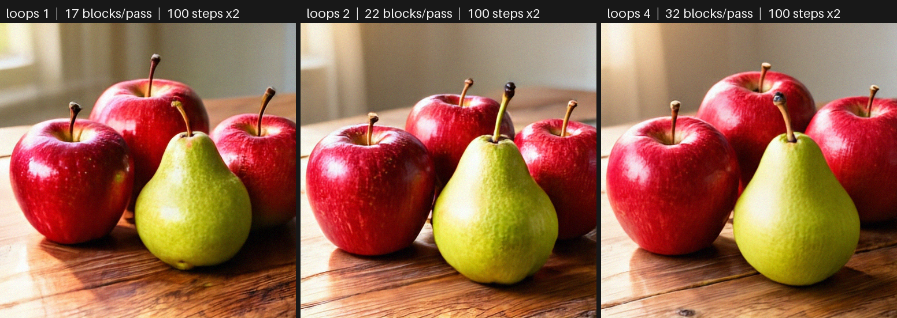
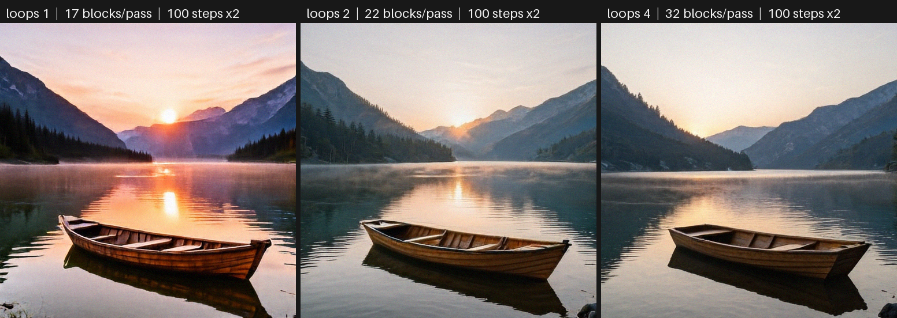
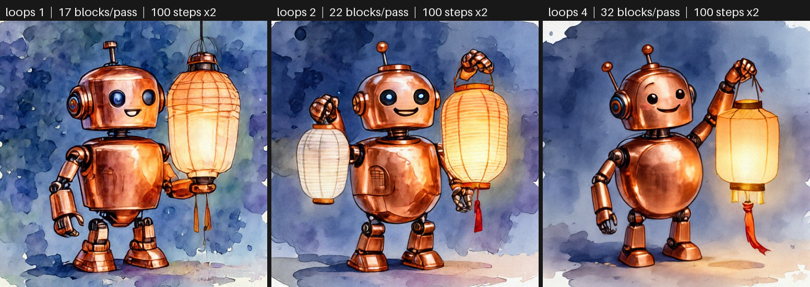

# Looped-DiT for ComfyUI

Unofficial ComfyUI nodes for [Looped-DiT](https://github.com/OpenSenseNova/Looped-DiT), a pixel-space text-to-image
diffusion transformer that runs a shared group of blocks several times inside every denoising step.

[日本語の概要](README.ja.md)



**Loop depth is not the number of sampling steps.** Every image here uses the official 100 Euler steps with
classifier-free guidance 6 (200 model passes). Loop depth N only changes how many times the shared middle blocks run
inside each pass: 6 + 5 x N + 6 blocks for B/16 (17, 22 and 32 blocks at N = 1, 2 and 4). The models were trained at N = 4.

## What this gives you

- **The official sampler's pixels in ComfyUI.** With the B/16 EMA checkpoint, the node's output is bit-identical (8-bit
  image and float32 result) to the official Looped-DiT code for all 27 images compared. That covers the official
  example prompt at loops 1/2/4 plus 4 prompts x 2 seeds x loops 1/2/4, run through ComfyUI's queue on an RTX 5090 under
  Windows. Token IDs, the FLAN-T5 embedding and the initial noise match as well. See [docs/VERIFICATION.md](docs/VERIFICATION.md).
- **A loop-depth comparison node.** *Loop Sweep* renders the same prompt, seed, initial noise, steps and CFG at several
  loop depths. Each depth is a separate full sampling run, one after another. The node returns every image, a labeled
  grid and a JSON report that shows the shared noise hash. The official `sample.py` offers the same comparison with
  `--loops 1 2 3 4`; this node brings it into a ComfyUI graph.
- **No extra Python packages.** Everything runs in the ComfyUI process, with ComfyUI's own torch, transformers and
  tokenizers. The official `model.py`, `diffusion.py` and `config.py` are vendored unmodified. There is no subprocess and
  no download at run time.
- **The tokenizer pitfall is handled.** Upstream pins `transformers < 5` because 5.x tokenizes trailing whitespace
  differently, while ComfyUI installs 5.x. The node tokenizes with the `tokenizers` library and the model's own
  `tokenizer.json`, and matches transformers 4.x on all 317 test prompts (transformers 5.18 differs on 301 of them).

## Selected examples

These are 3 of the 8 grids I generated, chosen by me. All 24 images, the 8 grids and every condition are in the
release asset `demo_images_v0.1.0.zip` and in [docs/results/demo_manifest.json](docs/results/demo_manifest.json).

| | |
| --- | --- |
|  |  |

All three grids use 512x512, 100 steps, CFG 6, and the same seed and initial noise within each grid. A higher loop depth
is not always better. In the robot grid, loops 2 draws two lanterns although the prompt asks for one. In the bicycle
prompt (in the zip), "on the left side of the door" is not clearly followed at any depth. These are my own observations,
not a benchmark; the scores in the upstream README are the authors' measurements, not mine.

## Nodes

| node | what it does |
| --- | --- |
| **Looped-DiT Loader** | Loads a checkpoint (EMA weights, bfloat16) and FLAN-T5-Large from `models/looped_dit`. It optionally checks SHA-256 against the official releases. One model stays resident; loading a different one frees the first. |
| **Looped-DiT Generate** | prompt, seed, loops (1-16), steps (official 100) and CFG (official 6.0) give an IMAGE and a JSON report. |
| **Looped-DiT Loop Sweep** | the same inputs with a list of loop depths (for example `1, 2, 4`) give the images, a labeled grid and a report. |
| **Looped-DiT Unload** | frees the model and text encoder (GPU and RAM). |

The unconditional pass of CFG uses the same text with an all-zero mask, as in the official code; there is no
negative-prompt input. A cancel stops between model passes and returns nothing for the unfinished sweep. The image is the
official 8-bit conversion (`x * 127.5 + 128`, clamp, truncate), so *Save Image* writes exactly the official pixels.

## Install

1. Clone into `ComfyUI/custom_nodes`:
   `git clone https://github.com/hiroki-abe-58/ComfyUI-LoopedDiT`
2. Download the models with ComfyUI's Python, at pinned revisions with SHA-256 checks:
   `python custom_nodes/ComfyUI-LoopedDiT/tools/download_models.py --models-dir models` (adds `--b32` for B/32).
   The resulting layout is:
   ```
   models/looped_dit/looped-dit-b16.pt                 (1.03 GB, MIT)
   models/looped_dit/flan-t5-large/{config.json, tokenizer.json, model.safetensors}   (3.1 GB, Apache-2.0)
   ```
3. Restart ComfyUI and open `workflows/gui/looped_dit_generate.json` or `looped_dit_loop_sweep.json`.

Requirements: ComfyUI 0.38.0 or later (tested with 0.38.0), and an NVIDIA GPU with CUDA. Generation peaks at about
1.9 GiB of CUDA memory at 512x512. Loading needs several GB of RAM for a short time: the 3.1 GB FLAN-T5 file plus the
checkpoint.

## Measured on an RTX 5090 (Windows 11, torch 2.14.1+cu130, ComfyUI 0.38.0)

| loops | blocks per model pass | model passes per image | denoising time (mean of 8) |
| --- | ---: | ---: | ---: |
| 1 | 17 | 200 (100 steps x cond/uncond) | 7.98 s |
| 2 | 22 | 200 | 10.19 s |
| 4 | 32 | 200 | 14.69 s |

A loops 1/2/4 sweep takes about 33.5 s from queueing to finished files. A single loops-4 image takes about 21.6 s,
including text encoding and saving. Loading takes 1.7 s for the model and 1.5 s for FLAN-T5, plus 2.6 s for the
first-time SHA-256 check.

## Limitations

- CUDA only. CPU and Apple Silicon (MPS/MLX) are not supported or tested; the porting notes in
  [docs/MPS_PORTING.md](docs/MPS_PORTING.md) are a plan only.
- Batch size 1; 512x512, as the released models are trained.
- ComfyUI's memory manager does not know about this model. Use *Looped-DiT Unload* to free it.
- Bit-identical results were checked on one GPU, driver and torch build, with ComfyUI's default flags. Other hardware or
  options such as `--fast` or `--deterministic` can change kernels and therefore pixels.
- B/32 was checked on the README example prompt only (seed 0, loops 1/2/4, bit-identical to the official code). The demo set uses B/16.
- Prompts are truncated to 256 tokens, as in the official code.

## Credits and license

Looped-DiT is by the Looped-DiT authors (OpenSenseNova) and builds on MiniT2I; the model weights are published by
SenseNova under the MIT license. FLAN-T5-Large is by Google (Apache-2.0). This repository is MIT-licensed; the vendored
upstream files keep their MIT notice. See [NOTICE](NOTICE). This is not an official project of the Looped-DiT authors.
